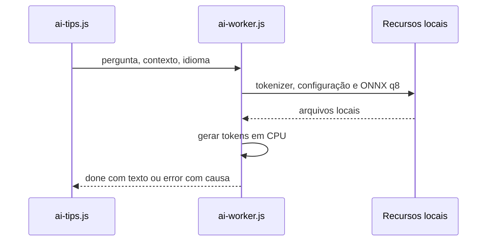

# Local SLM CPU Generation - Plan

## Goal Capsule

- **Objective:** Usuários do aplicativo Windows recebem uma resposta produzida pelo assistente local, inclusive sem GPU compatível, em vez de permanecerem no indicador de geração.
- **Means:** Substituir Qwen3 Q4F16 por um modelo instrucional ONNX quantizado que passe uma prova real de geração em CPU antes de integrar os recursos ao executável (KTD1).
- **Authority:** Pedido de troca do modelo e confirmação de funcionamento sem WebGPU; manter a calculadora, os imports, o protocolo NotMeter e as alterações pré-existentes fora do escopo.
- **Stop condition:** Não declarar o SLM funcional se o modelo apenas carregar, se o callback responder a uma mensagem simulada ou se o Windows não puder exercer a inferência real.
- **Execution:** `ce-work` implementa e verifica localmente; a publicação final do aplicativo exige validação no Windows com WebView2.

---

## Product Contract

### Summary

Trocar os pesos e a configuração do assistente por um modelo local que gere texto em CPU, mantendo a interface bilíngue e o executável autocontido.

### Problem Frame

O modelo Qwen3-0.6B Q4F16 atual requer WebGPU com `shader-f16`. O último teste local carregou seus pesos em CPU, mas falhou na primeira execução com incompatibilidade de tensor `float16`; o navegador disponível não encontrou adaptador WebGPU. A interface previamente corrigida entrega mensagens do worker, mas isso não prova que o modelo consiga gerar texto no equipamento do usuário.

### Requirements

**Geração**

- R1. Uma pergunta e uma sugestão automática geram uma resposta não vazia a partir de pesos ONNX locais em CPU, sem WebGPU.
- R2. O assistente continua a usar o contexto da calculadora e responde no idioma escolhido quando o modelo consegue atender ao pedido; falhas de carregamento ou inferência chegam à interface como erro, sem deixar a mensagem de geração pendente.

**Distribuição**

- R3. O executável Windows embute todos os recursos necessários à geração e não baixa pesos no computador do usuário.
- R4. A interface e a documentação identificam corretamente o modelo efetivamente distribuído e não afirmam exigir WebGPU após a migração.

### Key Decisions

- **Geração sem GPU obrigatória** (session-settled: user-approved — chosen over manter o requisito WebGPU: a máquina de teste não dispõe de adaptador e o usuário confirmou geração local em CPU). Governs R1, R3.

### Scope Boundaries

- Sem mudanças nas fórmulas de dano, na busca NotMeter, no catálogo de NPCs ou nas árvores de atributos.
- Não adicionar fallback silencioso que apresente texto fixo como se fosse saída gerada pelo modelo.
- As alterações já presentes em `README.md`, `i18n.js`, `index.html` e `style.css` pertencem ao trabalho anterior de interface; preservá-las e não incluí-las em commit sem escolha explícita sobre os arquivos compartilhados.

### Success Criteria

- A prova de inferência produz conteúdo de assistente para prompts curtos em inglês e português, sem depender da GPU; se o modelo escolhido não satisfizer a prova, interromper o cutover e selecionar outra variante por evidência, sem chamar o trabalho de concluído.
- A publicação não ultrapassa de forma material o tamanho aproximado de 688 MB do executável anterior; registrar tamanho observado, sem trocar por um modelo maior apenas para passar o teste.

---

## Planning Contract

### Key Technical Decisions

- KTD1. **Candidato primário: `onnx-community/Qwen2.5-0.5B-Instruct`, variante `model_quantized.onnx` (`q8`) em CPU/WASM.** A variante instrucional mantém melhor adequação ao diálogo bilíngue que um modelo base; seus pesos publicados têm cerca de 512 MB, contra cerca de 363 MB de `SmolLM2-360M-Instruct-ONNX` q8, cujo cartão limita o idioma principalmente ao inglês. Esta é uma escolha para testar, não alegação de geração já verificada. A seleção implementa R1 e R2; o arquivo e o tokenizer vêm da mesma revisão imutável do repositório do modelo. [Qwen ONNX](https://huggingface.co/onnx-community/Qwen2.5-0.5B-Instruct/tree/main/onnx), [SmolLM2 ONNX](https://huggingface.co/onnx-community/SmolLM2-360M-Instruct-ONNX/tree/main/onnx).
- KTD2. **Um único caminho de modelo para download, worker e recursos embutidos.** `build-ai.mjs`, `ai-worker.js`, `Aion2Calculator.csproj` e `Program.cs` precisam concordar com a localização de `model_quantized.onnx` e dos JSONs; o arquivo é verificado por hash no build e a rota HTTP local precisa servi-lo, pois uma compilação bem-sucedida sozinha não verifica recursos do WebView2. Cobre R3.
- KTD3. **Manter o contrato de eventos da interface.** `ai-tips.js` já recebe `loading`, `generating`, `done` e `error`; remover apenas o bloqueio antecipado por `shader-f16` e preservar associação da resposta à solicitação ativa. Cobre R1 e R2.

### High-Level Technical Design

### Risks & Dependencies

- A presença dos pesos e de uma variante `q8` no repositório público não prova que a combinação da versão instalada de Transformers.js com ONNX Runtime gere em CPU. A prova de geração deve preceder a substituição dos ativos atuais.
- Quantização e desempenho podem comprometer respostas em português e latência; medir geração real com os dois idiomas e registrar limites observados, sem prometer qualidade não medida.
- A verificação completa da interface WinForms/WebView2 continua dependente de Windows; uma prova Node em CPU não equivale a esse teste.

---

## Implementation Units

### U1. Comprovar modelo instrucional em CPU

- **Goal:** Selecionar uma variante ONNX que realmente produza texto nos dois idiomas antes de alterar o aplicativo.
- **Requirements:** R1, R2; KTD1.
- **Dependencies:** Nenhuma.
- **Files:** `ai-model.smoke.mjs` (novo), `package.json` (se for necessário expor um comando de smoke); pesos e JSONs provisórios em diretório temporário fora dos recursos distribuídos.
- **Approach:** Baixar para esse diretório uma revisão imutável com configuração, tokenizer e peso q8, registrar os hashes e usar a versão de Transformers.js instalada. Desativar acesso remoto durante a inferência e conferir texto gerado, não só a criação do pipeline. Se o candidato falhar, diagnosticar a incompatibilidade antes de escolher outra variante instrucional que também passe em inglês e português; não prosseguir para U2 com um candidato não comprovado.
- **Execution note:** Primeiro obter prova de geração real; não trocar a configuração de produção com base apenas em metadados do modelo.
- **Patterns to follow:** `build-ai.mjs` (ativos verificados), `ai-worker.js` (formato das mensagens).
- **Test scenarios:**
  - Com prompt curto em inglês e pesos locais, gerar ao menos uma resposta de assistente não vazia, distinta do prompt e sem acesso de rede.
  - Com prompt curto em português, gerar uma resposta não vazia em português; não aceitar um texto padrão fixo como prova.
- **Verification:** Smoke local de inferência em CPU concluído com saídas registradas nos dois idiomas; qualquer falha bloqueia U2.

### U2. Substituir ativos e conectar o worker

- **Goal:** Fazer o aplicativo usar apenas o modelo comprovado por U1, sem WebGPU obrigatório.
- **Requirements:** R1, R2, R3; KTD1–KTD3.
- **Dependencies:** U1.
- **Files:** `build-ai.mjs`, `ai-worker.js`, `ai-worker.bundle.js`, `ai-tips.js`, `Aion2Calculator.csproj`, `Program.cs`, `assets/ai/models/onnx-community/Qwen2.5-0.5B-Instruct/`, `ai-model.smoke.mjs`.
- **Approach:** Baixar a revisão pinada, verificar hashes, servir o ONNX e os JSONs pelo mesmo caminho do worker, reconstruir o bundle e remover referências/ativos obsoletos após o cutover. Usar CPU/WASM sem pré-condição WebGPU. Preservar estados e identificação de solicitação da interface.
- **Patterns to follow:** `Program.cs` (`ContentTypes` e `ServeEmbeddedResource`), `Aion2Calculator.csproj` (recursos lógicos), `ai-tips.js` (callback existente).
- **Test scenarios:**
  - Ao solicitar conselho automático e ao enviar pergunta, a resposta do worker chega ao elemento correto com texto gerado e não permanece em “Generating…”.
  - Quando o ONNX local não pode ser aberto, o worker retorna `error` e o usuário vê a causa em vez de esperar indefinidamente.
  - Com rede desabilitada após o build, configuração, tokenizer e peso são servidos localmente e uma resposta é produzida em CPU.
- **Verification:** Geração real via worker em cenário local sem GPU e rotas dos recursos com respostas válidas; não considerar um mock de mensagem como prova da geração.

### U3. Alinhar comunicação e distribuição

- **Goal:** Publicar instruções e executável correspondentes ao modelo efetivamente testado.
- **Requirements:** R3, R4.
- **Dependencies:** U2.
- **Files:** `README.md`, `index.html`, `i18n.js`, `ai-model.smoke.mjs`.
- **Approach:** Atualizar o nome e os requisitos reais do modelo, mantendo as alterações anteriores da aba de atributos nesses arquivos; publicar Release Windows com somente os ativos novos.
- **Patterns to follow:** `i18n.js` (paridade PT/EN), `README.md` (instruções de build e limitações).
- **Test scenarios:**
  - Com idioma português e inglês, o texto informativo da interface descreve o modelo distribuído e não exige GPU.
  - Após publicação, o executável contém os recursos do modelo novo, não os pesos antigos, e o tamanho é registrado.
- **Verification:** Suíte Node existente, smoke de inferência real, publicação Release e verificação do executável; testar manualmente a interface WebView2 em Windows antes de afirmar conclusão da geração no aplicativo.

---

## Verification Contract

- `node --test *.test.js`: manter os 32 testes existentes aprovados e atualizar testes de interface que dependam de nome ou requisitos do modelo.
- `node ai-model.smoke.mjs`: gerar respostas reais localmente em CPU, offline, em inglês e português; não inserir um teste dependente de 512 MB de pesos na suíte rápida por padrão.
- `node build-ai.mjs`: conferir hash e reconstruir o worker e os ativos empacotados antes da publicação.
- `dotnet publish Aion2Calculator.csproj -c Release -o dist/webview2`: gerar executável único Win x64, observar tamanho e conferir recursos embutidos.
- No Windows com WebView2: abrir o executável publicado, pedir conselho e verificar resposta ou erro explícito; se este ambiente não estiver disponível, informar a limitação sem alegar prova de geração no aplicativo.

---

## Definition of Done

- A solicitação real produz texto novo em CPU e chega ao chat, sem requisito de WebGPU nem download no computador do usuário.
- Configuração, tokenizer e ONNX têm caminhos consistentes em build, bundle e servidor de recursos; versões e hashes ficam pinados.
- Os testes rápidos continuam passando e a publicação Windows inclui somente o novo modelo; documentar tamanho e restrições medidas.
- Código e ativos da tentativa abandonada são removidos após a migração, preservando alterações anteriores não relacionadas. Nenhuma mensagem simulada, fallback estático ou sucesso apenas de compilação substitui a prova de inferência.
